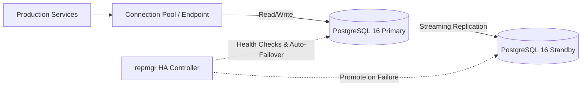
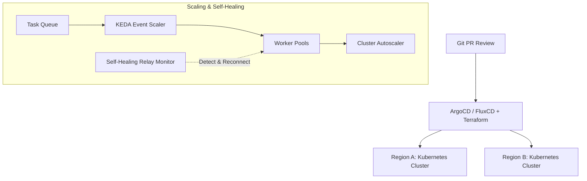
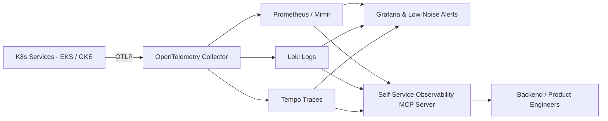

# Mayuresh Mudrale — Production SRE & Infrastructure Portfolio

**Senior Infrastructure & Site Reliability Engineer** with 6 years of experience running high-availability production systems on **AWS (EKS)**, multi-cloud **Kubernetes**, **Terraform/GitOps**, **PostgreSQL**, and **OpenTelemetry**.

> **Note for Reviewers & Interviewers:** Because most of my production infrastructure, Kubernetes, and database engineering work lives in private enterprise repositories, this repository serves as a sanitized technical portfolio of production systems I have architected, scaled, and debugged. I am happy to walk through any architecture, trade-off, or incident deep dive in detail during a technical review.

---

## Impact at a Glance

| Area | Outcome | Stack & Approach |
| :--- | :--- | :--- |
| **Incident Response (MTTR)** | **-50% MTTR** | OpenTelemetry, Prometheus, Grafana, Loki, Mimir, Tempo + low-noise alerting |
| **Cloud Cost & Scaling** | **-40% Cloud Spend** | KEDA, Cluster Autoscaler, Celery worker parallelism redesign |
| **Database Reliability** | **+25% Query Perf, 0 Downtime** | PostgreSQL 12 → 16 migration + automated HA failover (`repmgr`) |
| **Multi-Region Delivery** | **-90% Region Setup Time** | Terraform, Helm, ArgoCD, FluxCD, automated TLS/DNS with rollback |
| **Latency Engineering** | **~3 min → <10s** | Connection pooling, 20-worker parallel prefetching, async pipelines |

---

## Production Case Studies

### 1. Zero-Downtime PostgreSQL 12 → 16 Migration & Automated HA Failover
* **Problem:** A production PostgreSQL 12 cluster required a major version upgrade and automated high availability without interrupting live traffic or relying on manual failover during incidents.
* **Solution:**
  * Architected a streaming replication topology managed by **`repmgr`** for automated health checks, witness/quorum handling, and failover.
  * Executed a staged cutover with pre-flight validation, connection draining, and a verified rollback path.
* **Result:** **Zero downtime** during the upgrade, **25% query performance improvement**, and automated recovery replacing manual intervention.

---

### 2. Workload-Aware Kubernetes Scaling & Multi-Region Self-Healing
* **Problem:** Static node pools and inefficient worker parallelism inflated cloud compute spend while risking queue backlogs under bursty traffic. Separately, a silent half-dead relay connection caused intermittent cross-region failures in production.
* **Solution:**
  * Redesigned Celery worker parallelism and paired **KEDA** (queue/event-driven pod scaling) with **Cluster Autoscaler** and capacity-aware scheduling (Hatchet + Celery Beat with per-tenant dispatch budgets).
  * Standardized multi-region promotion using **Terraform, Helm, ArgoCD, and FluxCD**, automating infrastructure, TLS, and DNS provisioning with rollback support.
  * Root-caused the silent half-dead relay failure and shipped a **self-healing detect-and-reconnect mechanism** with retry and device lease management across multi-region Kubernetes, backed by an authenticated HTTP-over-WebSocket reverse proxy with a fail-closed internal auth gate.
* **Result:** **40% reduction in cloud spend**, **90% faster new-region provisioning**, and automated recovery from silent network partitions.

---

### 3. Production Observability (OpenTelemetry + LGTM) & Self-Service Tooling
* **Problem:** High incident MTTR, alert fatigue across distributed AWS/GCP Kubernetes clusters, and developers waiting on infrastructure engineers to pull telemetry during outages.
* **Solution:**
  * Designed and operated a unified observability stack (**OpenTelemetry, Prometheus, Grafana, Loki, Mimir, Tempo**) across multi-environment AWS and GKE clusters.
  * Built targeted, low-noise alerting ("monitoring that earns its pages") tied to actionable runbooks.
  * Built a custom **Model Context Protocol (MCP) server** exposing production metrics, logs, and traces as safe, read-scoped self-service tools for engineers and automated workflows—improving debug velocity without granting broad cluster permissions.
* **Result:** **50% reduction in production MTTR** and self-service incident triage without weakening access controls.

---

### 4. End-to-End Latency Engineering (~3 Minutes → Under 10 Seconds)
* **Problem:** High-load processing pipelines suffered ~3-minute end-to-end latency due to sequential execution and connection overhead.
* **Solution:**
  * Eliminated bottlenecks using connection pooling, 20-worker parallel prefetching, asynchronous pipelines (`asyncio`), and early-exit scoring.
  * Deployed and tuned open-source model serving (**GoLLIE-7B**) on GPU-enabled Kubernetes (GKE) alongside provider-agnostic routing with automatic failover on timeouts and rate limits.
* **Result:** Cut end-to-end latency from **~3 minutes to under 10 seconds** while maintaining graceful degradation under load.

---

## Core Technical Stack

* **Cloud & Networking:** AWS (EC2, S3, RDS, VPC, IAM, ECS, Lambda), GCP, Azure, Oracle Cloud, Cloudflare, IPsec, WireGuard
* **Containers & IaC:** Kubernetes (EKS, GKE, AKS, OKE), Docker, Helm, Terraform, Ansible, ArgoCD, FluxCD, GitHub Actions, Jenkins
* **Observability:** OpenTelemetry, Prometheus, Grafana, Loki, Mimir, Tempo, ELK, Langfuse
* **Data:** PostgreSQL, `repmgr`, AWS RDS, Redis, Elasticsearch
* **Languages & Backend:** Python, Go, Shell, JavaScript, Java, Django, Celery, Hatchet, `asyncio`, WebSockets, REST APIs

---

## How I Operate Production Systems

* **Immutable & Reproducible by Default:** Every infrastructure change is code, reviewed in Git, and one-click reversible.
* **Monitoring That Earns Its Pages:** Alert on symptoms 
* **Paved Paths Over Gatekeeping:** Pair security and reliability controls with self-service tooling so the safest path is also the fastest path.

---

## Contact

* **Email:** mayureshmudrale@gmail.com
* **LinkedIn:** [linkedin.com/in/mayureshmudrale](https://linkedin.com/in/mayureshmudrale)
